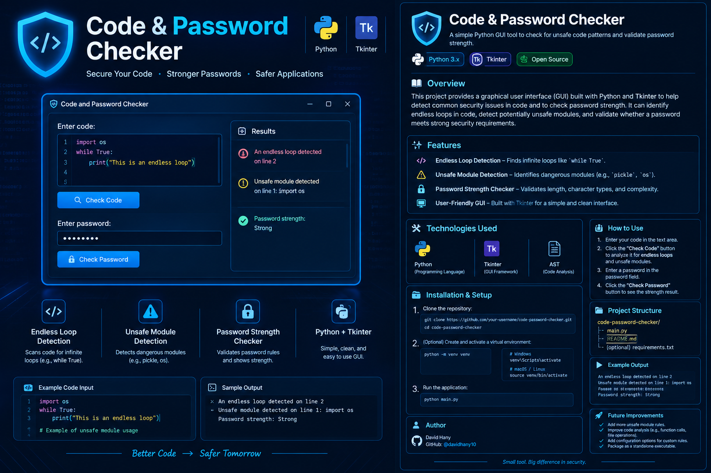

 
# 🔐 Code & Password Checker

<p align="center">
  
</p>

<p align="center">
  A lightweight Python desktop application for detecting selected code patterns and validating password strength.
</p>

<p align="center">
  
  
  
  
</p>

---

## 📌 Overview

**Code & Password Checker** is a simple desktop application built with Python and Tkinter. It combines two basic security utilities in one graphical interface:

- **Code Pattern Checker:** Scans Python source code for selected patterns, including `while True` loops and imports matching a small predefined list of modules.
- **Password Strength Checker:** Validates a password against basic length and character-composition requirements.

The project demonstrates Python Abstract Syntax Tree (AST) traversal, string validation, and desktop GUI development.

## ✨ Features

### 1. Code Analysis

The application parses the submitted code using Python's `ast` module.

- Detects `while True` loops represented by a constant Boolean condition.
- Checks imports against a predefined list containing `pickle` and `os`.
- Reports the line number associated with a detected pattern.
- Displays the result in a graphical message box.

**Important:** These are basic pattern checks, not a complete security audit or proof that code is safe.

### 2. Password Strength Validation

The password checker evaluates five requirements:

| Requirement | Validation |
|---|---|
| Minimum length | At least 8 characters |
| Uppercase | At least one uppercase letter |
| Lowercase | At least one lowercase letter |
| Numeric character | At least one digit |
| Special character | At least one character from the configured special-character set |

When all checks pass, the application displays `Password strength: Strong`.

This is a basic rules-based check; it does not measure password entropy, detect compromised passwords, or guarantee resistance to attacks.

### 3. Desktop GUI

The application uses Tkinter and `ttk` widgets to provide:

- A multiline text field for entering code.
- A **Check Code** button.
- A masked password entry field.
- A **Check Password** button.
- Message boxes displaying analysis results.

## 🛠️ Technologies Used

| Technology | Purpose |
|---|---|
| Python 3 | Application logic |
| Tkinter | Graphical user interface |
| `tkinter.ttk` | Themed GUI widgets |
| `ast` | Python source-code parsing and syntax-tree traversal |

The supplied implementation uses Python's standard library and does not require a third-party package for its core functionality.

## 📂 Project Structure

```text
Code-Password-Checker/
│
├── david.py
├── README.md
└── docs/
    └── images/
        └── banner.png
```

The structure above represents the suggested documentation layout. Keep the Python source file's actual name consistent with the command used to run it.

## ⚙️ Installation & Setup

### Prerequisites

- Python 3 installed on your computer.
- A Python installation that includes Tkinter.

Check your Python version:

```bash
python --version
```

### 1. Clone the Repository

```bash
git clone YOUR_REPOSITORY_URL
cd YOUR_REPOSITORY_FOLDER
```

Replace the placeholders with your actual GitHub repository URL and folder name.

### 2. Run the Application

If the source file is named `david.py`, execute:

```bash
python david.py
```

The Code and Password Checker window should open.

On some Linux distributions, Tkinter may need to be installed separately through the operating system's package manager.

## 🚀 How to Use

### Check Python Code

1. Open the application.
2. Enter Python source code in the **Enter code** text area.
3. Click **Check Code**.
4. Review the message box for detected patterns.

Example input:

```python
import os

while True:
    print("Example loop")
```

The current implementation can report the constant `while True` loop and the matching `os` import.

### Check Password Strength

1. Enter a password in the password field.
2. Click **Check Password**.
3. Review the validation message.
4. If a requirement fails, update the password and check it again.

For privacy, avoid entering real account passwords into demonstration or untrusted applications.

## 🔍 How the Code Checker Works

The code-analysis workflow is:

1. Read the text entered in the editor.
2. Parse the source using `ast.parse()`.
3. Traverse the syntax tree using `ast.walk()`.
4. Inspect `while` loop conditions and import statements.
5. Return the first matching finding for each detector.
6. Display the results through a Tkinter message box.

The password-validation workflow checks the password's length and character composition in sequence, returning the first failed requirement or a success message.

## ⚠️ Limitations

The current version is an educational prototype, not a production-grade static analysis tool.

- It checks only selected syntax patterns.
- It does not detect every infinite loop or unsafe API.
- Its import checks do not cover aliases, indirect imports, or all ways a module can be accessed.
- It does not execute or dynamically analyze the submitted code.
- Password validation uses simple composition rules rather than a comprehensive strength estimator.
- The GUI does not currently provide a full findings dashboard, severity scoring, or detailed remediation guidance.

## 🔮 Future Improvements

- Add configurable security rules.
- Expand AST-based analysis to identify more suspicious code patterns.
- Display all findings instead of returning only the first match per detector.
- Add line-by-line findings with severity levels.
- Improve handling of invalid Python syntax.
- Integrate a password-strength estimator and compromised-password checks.
- Add unit tests for code analysis and password validation.
- Package the application as a standalone executable.

## 👨‍💻 Author

**David Hany**

Computer Science & Artificial Intelligence · Cybersecurity

GitHub: [@davidhany10](https://github.com/davidhany10)

---

<p align="center">
  <strong>Better Code → Safer Tomorrow</strong>
</p>
